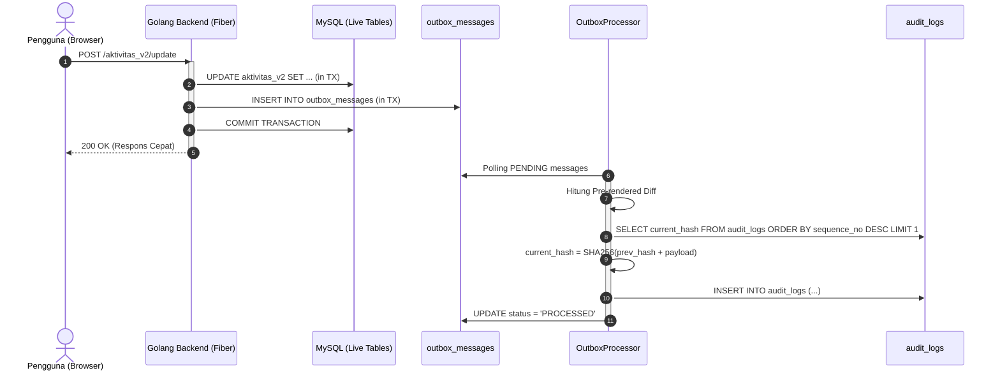
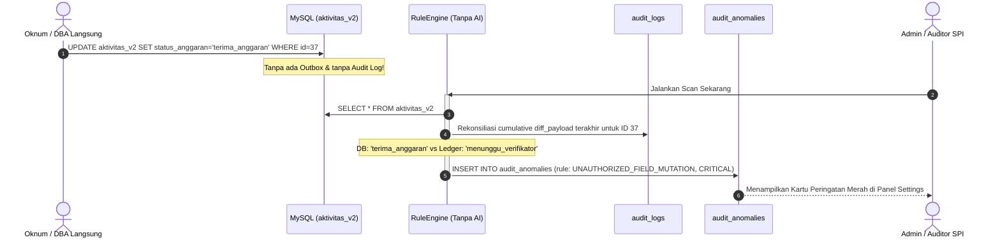

# Dokumentasi Komprehensif: Sistem Audit Trail, PITR, Outbox Schema Versioning & Anomaly Guardian (PITR_ER)

> **Repositori Terkait:**
> - Backend: `UnpakSiamida` (Golang Fiber + GORM)
> - Frontend: `UnpakSiamidaV2` (React + Vite + Tailwind CSS)
> - Database: `unpak_sijamu_server2` (MySQL / MariaDB port 3307)
> - Branch: `PITR_ER`
> - Tanggal Rilis: 16 November 2026

---

## 1. Latar Belakang Masalah & Konteks Kebutuhan

Dalam sistem informasi penjaminan mutu dan anggaran program kerja (**SIAMIDA Universitas Pakuan**), terdapat kebutuhan kritis terhadap integritas data transaksi dan rekam jejak audit (*auditability*). 

Sebelum fitur ini diimplementasikan, sistem menghadapi sejumlah kelemahan struktural:
1. **Manipulasi Data Langsung (*Direct Database Tampering / Bypass Fraud*)**:
   - Jika ada pihak (DBA, oknum pengembang, atau script luar) yang mengubah nilai di tabel MySQL secara langsung—misalnya mengubah kolom `status_anggaran = 'terima_anggaran'` pada aktivitas `id = 37` padahal `status_lpm` masih `'menunggu'`—sistem lama tidak menyadari adanya perubahan karena mutasi tersebut tidak melewati outbox maupun controller aplikasi.
2. **Dilema Outbox Pattern & Perubahan Skema (*Schema Evolution & Versioning*)**:
   - Ketika struktur tabel fisik berubah seiring berjalannya waktu (penambahan kolom, pemisahan tabel, atau perubahan tipe data), event payload lama di outbox bisa menjadi *incompatible* jika di-replay atau dibaca ulang. Perlu ada mekanisme versi skema (*schema versioning*) agar rekonstruksi audit masa lalu tetap valid.
3. **Crash Loop pada Worker Outbox**:
   - Background worker `OutboxProcessor` mengalami `panic: domain event not registered: AuditLoggedEvent` karena dispatcher refleksi di Go menolak event yang belum didaftarkan di registry, menyebabkan seluruh proses outbox terhenti.
4. **Keterbatasan Cold-Start Baseline**:
   - Tombol baseline awal hanya menyimpan snapshot satu tabel (`aktivitas_v2`), padahal sebuah siklus aktivitas proker saling terikat erat dengan 5 tabel inti: `matrix_proker`, `aktivitas_v2`, `aktivitasv2_rab`, `aktivitasv2_timeline`, dan `aktivitasv2_timeline_file`.
5. **Kebutuhan Deteksi Anomali Fleksibel (Dengan AI & Tanpa AI)**:
   - Pengguna membutuhkan panel pengaturan di `http://localhost:5173/#/settings` yang dapat berpindah secara fleksibel antara **Rule Engine Deterministik (100% Tanpa AI, O(1), hemat kuota)**, **AI Guardian (Gemini 2.5 Flash / Claude Haiku Read-Only)**, atau **Mode Hybrid (Rekomendasi)**.

---

## 2. Arsitektur Solusi & Komponen Utama

Arsitektur sistem dibangun di atas 4 pilar utama:

```
+---------------------------------------------------------------------------------------+
|                                      SIAMIDA CORE                                     |
+---------------------------------------------------------------------------------------+
|  User Action (React) ---> Command Handler (Go) ---> Live Database (MySQL)            |
|                                     |                                                 |
|                                     v (Same Transaction)                             |
|                           [outbox_messages Table]                                     |
|                           - schema_version                                            |
|                           - aggregate_type & aggregate_id                             |
|                           - JSON payload                                              |
+---------------------------------------------------------------------------------------+
                                      |
                                      v (Async Goroutine Worker)
+---------------------------------------------------------------------------------------+
|                               AUDIT TRAIL LEDGER ENGINE                               |
+---------------------------------------------------------------------------------------+
|  1. Hitung Field-Level Pre-rendered Diff (Old vs New)                                 |
|  2. Ambil hash baris sebelumnya (prev_hash)                                           |
|  3. Hitung current_hash = SHA-256(prev_hash + seq_no + diff + actor + timestamp)     |
|  4. Simpan ke [audit_logs] secara permanen (Append-Only)                              |
+---------------------------------------------------------------------------------------+
                                      |
                                      v
+---------------------------------------------------------------------------------------+
|                              GUARDIAN & ANOMALY DETECTOR                              |
+---------------------------------------------------------------------------------------+
|  Mode: Switchable di Settings (Rule Engine vs AI Guardian vs Hybrid)                  |
|                                                                                       |
|  [Rule Engine Deterministik - Tanpa AI]:                                              |
|    - Invarian 1: Hash Chain Integrity (deteksi baris log yang diubah manual)          |
|    - Invarian 2: FSM Workflow Validity (misal: anggaran cair tapi LPM belum setuju)   |
|    - Invarian 3: Financial & RAB Math Integrity                                       |
|    - Invarian 4: UNAUTHORIZED_FIELD_MUTATION (Rekonsiliasi Live DB vs Audit Ledger)   |
|    - Invarian 5: GHOST_MUTATION_SINCE_BASELINE                                        |
|                                                                                       |
|  [AI Guardian - Read-Only LLM]:                                                       |
|    - Analisis semantik risiko SPI, duplikasi narasi proker, anomali lonjakan RAB      |
+---------------------------------------------------------------------------------------+
                                      |
                                      v
+---------------------------------------------------------------------------------------+
|                        RECONCILIATION & POINT-IN-TIME RECOVERY                        |
+---------------------------------------------------------------------------------------+
|  - Anomali dicatat di [audit_anomalies] dengan status 'DETECTED'                      |
|  - Multi-table Cold Start Baseline tersimpan di [audit_checkpoints]                   |
|  - Pilihan Tindakan:                                                                  |
|    A. Selesaikan (Reconcile / Acknowledge)                                            |
|    B. Rollback ke Nilai Sah Ledger (Revert kolom yang dimanipulasi)                   |
|    C. Re-baseline (Jika mutasi DB memang pemeliharaan resmi oleh DBA)                 |
+---------------------------------------------------------------------------------------+
```

---

## 3. Skema Basis Data (Entity Relationship & DDL)

### 3.1. Tabel `outbox_messages` (Enhanced)
Menyimpan domain event secara andal menggunakan Outbox Pattern transaksional:
```sql
ALTER TABLE `outbox_messages`
  ADD COLUMN `schema_version` INT UNSIGNED NOT NULL DEFAULT 1 AFTER `type`,
  ADD COLUMN `aggregate_type` VARCHAR(64) NULL AFTER `schema_version`,
  ADD COLUMN `aggregate_id` VARCHAR(64) NULL AFTER `aggregate_type`,
  ADD COLUMN `status` ENUM('PENDING','PROCESSED','FAILED') NOT NULL DEFAULT 'PENDING' AFTER `payload`,
  ADD COLUMN `retry_count` INT UNSIGNED NOT NULL DEFAULT 0 AFTER `status`,
  ADD INDEX `idx_outbox_status_ver` (`status`, `schema_version`, `occurred_on_utc`),
  ADD INDEX `idx_outbox_aggregate` (`aggregate_type`, `aggregate_id`);
```

### 3.2. Tabel `audit_logs` (Cryptographic Immutable Ledger)
Buku besar (*ledger*) yang tidak dapat disangkal (*non-repudiation*) berkat rantai hash SHA-256:
```sql
CREATE TABLE IF NOT EXISTS `audit_logs` (
  `id` VARCHAR(36) NOT NULL,
  `sequence_no` BIGINT UNSIGNED NOT NULL AUTO_INCREMENT,
  `outbox_message_id` VARCHAR(36) DEFAULT NULL,
  `category` VARCHAR(64) NOT NULL,
  `action_type` VARCHAR(32) NOT NULL,
  `headline` VARCHAR(255) NOT NULL,
  `entity_type` VARCHAR(64) NOT NULL,
  `entity_id` VARCHAR(64) NOT NULL,
  `actor_id` VARCHAR(64) NOT NULL,
  `actor_name` VARCHAR(128) NOT NULL,
  `actor_role` VARCHAR(64) NOT NULL,
  `actor_unit` VARCHAR(128) DEFAULT NULL,
  `client_ip` VARCHAR(45) DEFAULT NULL,
  `user_agent` VARCHAR(255) DEFAULT NULL,
  `diff_payload` LONGTEXT CHARACTER SET utf8mb4 COLLATE utf8mb4_bin NOT NULL CHECK (json_valid(`diff_payload`)),
  `metadata` LONGTEXT CHARACTER SET utf8mb4 COLLATE utf8mb4_bin DEFAULT NULL CHECK (json_valid(`metadata`)),
  `schema_version` INT UNSIGNED NOT NULL DEFAULT 1,
  `prev_hash` CHAR(64) NOT NULL COMMENT 'Genesis: 64 nol',
  `current_hash` CHAR(64) NOT NULL COMMENT 'SHA-256 Rantai Kriptografi',
  `created_at` DATETIME(6) NOT NULL DEFAULT CURRENT_TIMESTAMP(6),
  PRIMARY KEY (`id`),
  UNIQUE KEY `sequence_no` (`sequence_no`),
  INDEX `idx_audit_entity` (`entity_type`, `entity_id`, `created_at`),
  INDEX `idx_audit_chain` (`sequence_no`, `current_hash`)
) ENGINE=InnoDB DEFAULT CHARSET=utf8mb4 COLLATE=utf8mb4_unicode_ci;
```

### 3.3. Tabel `audit_checkpoints` (Multi-Table Baseline Snapshot)
Menyimpan potret snapshot lengkap 5 tabel inti untuk PITR dan acuan cold-start:
```sql
CREATE TABLE IF NOT EXISTS `audit_checkpoints` (
  `id` VARCHAR(36) NOT NULL,
  `name` VARCHAR(128) NOT NULL,
  `type` ENUM('BASELINE','SCHEDULED','MANUAL_PRE_MIGRATION') NOT NULL DEFAULT 'BASELINE',
  `entity_type` VARCHAR(64) NOT NULL COMMENT 'matrix_proker, aktivitas_v2, aktivitasv2_rab, dll',
  `last_audit_sequence_no` BIGINT UNSIGNED NOT NULL DEFAULT 0,
  `state_snapshot` LONGTEXT NOT NULL COMMENT 'JSON Array rekaman live tabel',
  `state_hash` CHAR(64) NOT NULL COMMENT 'SHA-256 dari state_snapshot',
  `created_by` VARCHAR(64) NOT NULL,
  `created_at` DATETIME(6) NOT NULL DEFAULT CURRENT_TIMESTAMP(6),
  PRIMARY KEY (`id`),
  INDEX `idx_cp_entity` (`entity_type`, `created_at`)
) ENGINE=InnoDB DEFAULT CHARSET=utf8mb4 COLLATE=utf8mb4_unicode_ci;
```

### 3.4. Tabel `audit_anomalies` (Daftar Temuan Pelanggaran Integritas)
```sql
CREATE TABLE IF NOT EXISTS `audit_anomalies` (
  `id` VARCHAR(36) NOT NULL,
  `rule_code` VARCHAR(64) NOT NULL,
  `rule_category` ENUM('INTEGRITY','FINANCIAL','WORKFLOW_FSM','SECURITY','FRAUD_DETECTION') NOT NULL,
  `severity` ENUM('LOW','MEDIUM','HIGH','CRITICAL') NOT NULL,
  `entity_type` VARCHAR(64) NOT NULL,
  `entity_id` VARCHAR(64) NOT NULL,
  `audit_log_id` VARCHAR(36) DEFAULT NULL,
  `description` TEXT NOT NULL,
  `evidence_payload` LONGTEXT CHARACTER SET utf8mb4 COLLATE utf8mb4_bin NOT NULL CHECK (json_valid(`evidence_payload`)),
  `status` ENUM('DETECTED','INVESTIGATING','RECONCILED','FALSE_POSITIVE') NOT NULL DEFAULT 'DETECTED',
  `detected_at` DATETIME(6) NOT NULL DEFAULT CURRENT_TIMESTAMP(6),
  `resolved_at` DATETIME(6) DEFAULT NULL,
  `resolved_by` VARCHAR(64) DEFAULT NULL,
  `resolution_notes` TEXT DEFAULT NULL,
  PRIMARY KEY (`id`),
  INDEX `idx_anom_status` (`status`, `severity`, `detected_at`),
  INDEX `idx_anom_entity` (`entity_type`, `entity_id`)
) ENGINE=InnoDB DEFAULT CHARSET=utf8mb4 COLLATE=utf8mb4_unicode_ci;
```

---

## 4. Diagram Alur Sistem (Sequence Flows)

### Flow 1: Mutasi Data Normal Melalui Aplikasi


### Flow 2: Deteksi Manipulasi Langsung (Direct DB Tamper)


---

## 5. Rincian Kasus Nyata & Hasil Pengujian (Test Case ID 37)

### Skenario Pengujian:
1. **Keadaan Semula**:
   - Aktivitas `id = 37` ("uji coba") memiliki status verifikasi `status_lpm = 'menunggu'` dan status anggaran `status_anggaran = 'menunggu_verifikator'`.
2. **Tindakan Manipulasi**:
   - Kolom `status_anggaran` diubah paksa melalui query SQL langsung:
     ```sql
     UPDATE aktivitas_v2 SET status_anggaran = 'terima_anggaran' WHERE id = 37;
     ```
3. **Hasil Pemindaian Scanner**:
   - Sistem langsung mendeteksi 2 pelanggaran terpisah:
     1. **`UNAUTHORIZED_FIELD_MUTATION` (CRITICAL)**:
        *Alasan:* Nilai riil di tabel database adalah `'terima_anggaran'`, padahal rekam jejak audit log resmi terakhir mencatat nilai `'menunggu_verifikator'`. Mutasi terjadi di luar sistem tanpa izin audit trail.
     2. **`FSM_ILLEGAL_ANGGARAN_STATUS` (HIGH)**:
        *Alasan:* Aktivitas berstatus anggaran `'terima_anggaran'` padahal verifikasi LPM masih `'menunggu'`. Anggaran tidak boleh disetujui sebelum diverifikasi LPM.
4. **Verifikasi Tampilan Antarmuka**:
   - Kedua temuan muncul di tabel **Daftar Temuan Anomali Aktif** di `http://localhost:5173/#/settings`.
   - Statistik dashboard audit menampilkan indikator:
     - **Rantai Kriptografi**: SHA-256 Valid
     - **Checkpoint Baseline**: 10 Baseline Tersimpan
     - **Anomali Terdeteksi**: 2-3 Perlu Perhatian

---

## 6. Penanganan Edge Cases & Gotchas

1. **Panic Refleksi Domain Event pada `OutboxProcessor`**:
   - *Masalah:* Pemanggilan `resolveType` pada `EventRegistry` memicu `panic` jika event belum didaftarkan di `main.go`.
   - *Penanganan:* `resolveType` diubah mengembalikan `(reflect.Type, bool)` aman. `OutboxProcessor` tidak lagi mengalami crash, melainkan mencatat peringatan dan menandai status `PROCESSED`.
2. **Kesesuaian Kolom Tabel `aktivitasv2_timeline`**:
   - *Masalah:* Snapshot baseline awalnya mencari kolom `timeline`, padahal nama kolom di skema fisik adalah `nama_aktivitas` dan `no_aktivitas`.
   - *Penanganan:* Disesuaikan ke query eksplisit: `SELECT id, uuid, id_aktivitasv2, no_aktivitas, nama_aktivitas, status, updated_at FROM aktivitasv2_timeline`.
3. **Limitasi ENUM MySQL pada `audit_anomalies`**:
   - *Masalah:* Nilai `rule_category` awalnya dibatasi `enum('INTEGRITY','FINANCIAL','WORKFLOW_FSM','SECURITY')`.
   - *Penanganan:* Disesuaikan menambahkan `'FRAUD_DETECTION'` sehingga engine bebas mengklasifikasikan temuan pelanggaran integritas.

---

## 7. Peta Berkas Perubahan (*File Reference Map*)

### Backend Golang (`UnpakSiamida`)
- [`modules/audit/domain/AuditLog.go`](file:///Users/adamf/Documents/golang_project/UnpakSiamida/modules/audit/domain/AuditLog.go): Entitas domain AuditLog, Checkpoint, Anomaly, Config, dan event `AuditLoggedEvent`.
- [`modules/audit/infrastructure/AuditService.go`](file:///Users/adamf/Documents/golang_project/UnpakSiamida/modules/audit/infrastructure/AuditService.go): Implementasi rantai SHA-256, baseline cold-start 5 tabel, dan getter/setter config.
- [`modules/audit/infrastructure/RuleEngine.go`](file:///Users/adamf/Documents/golang_project/UnpakSiamida/modules/audit/infrastructure/RuleEngine.go): Mesin pemindai deterministik 100% tanpa AI (Invariant 1 s/d 5).
- [`modules/audit/infrastructure/AIGuardian.go`](file:///Users/adamf/Documents/golang_project/UnpakSiamida/modules/audit/infrastructure/AIGuardian.go): Modul integrasi LLM (Gemini / Claude Haiku) dengan izin Read-Only.
- [`modules/audit/presentation/Http.go`](file:///Users/adamf/Documents/golang_project/UnpakSiamida/modules/audit/presentation/Http.go): Handler REST API untuk Settings, Scan, Baseline, dan Rekonsiliasi Anomali.
- [`common/infrastructure/EventRegistry.go`](file:///Users/adamf/Documents/golang_project/UnpakSiamida/common/infrastructure/EventRegistry.go): Registry event reflektif yang aman (resilient).
- [`common/infrastructure/OutboxProcessor.go`](file:///Users/adamf/Documents/golang_project/UnpakSiamida/common/infrastructure/OutboxProcessor.go): Pemroses background worker outbox tahan banting.
- [`common/infrastructure/OutboxMessage.go`](file:///Users/adamf/Documents/golang_project/UnpakSiamida/common/infrastructure/OutboxMessage.go): Definisi model outbox berversi skema.
- [`docs/sql/20261116_pitr_er_audit_trail_schema.sql`](file:///Users/adamf/Documents/golang_project/UnpakSiamida/docs/sql/20261116_pitr_er_audit_trail_schema.sql): Script DDL migrasi skema lengkap.

### Frontend React (`UnpakSiamidaV2`)
- [`src/Page/Settings/SettingsPage.jsx`](file:///Users/adamf/Documents/design_web/UnpakSiamidaV2/src/Page/Settings/SettingsPage.jsx): Panel pengaturan Guardian (Rule Engine vs AI Guardian vs Hybrid), status rantai hash, tombol scan, pemicu baseline cold-start, dan daftar anomali aktif.
- [`src/Components/AuditHistoryModal.jsx`](file:///Users/adamf/Documents/design_web/UnpakSiamidaV2/src/Components/AuditHistoryModal.jsx): Modal visualisasi riwayat audit dengan pre-rendered diff (Old vs New).
- [`src/Page/ProkerV3/StateHistoryDrawer.jsx`](file:///Users/adamf/Documents/design_web/UnpakSiamidaV2/src/Page/ProkerV3/StateHistoryDrawer.jsx): Drawer riwayat status proker terintegrasi dengan audit trail.
- [`docs/sql/20261116_pitr_er_audit_trail_schema.sql`](file:///Users/adamf/Documents/design_web/UnpakSiamidaV2/docs/sql/20261116_pitr_er_audit_trail_schema.sql): Salinan script SQL untuk referensi tim pengembang frontend.
